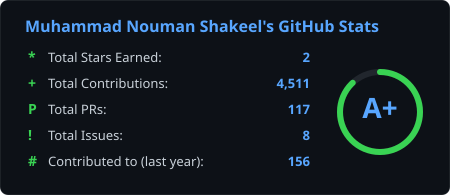
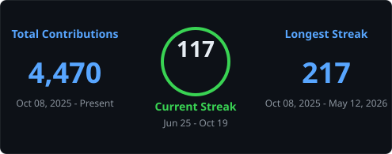

<div align="center">

<picture>
  <source media="(max-width: 768px)" srcset="./assets/hero-mobile.png" />
  
</picture>

</div>

# Muhammad Nouman Shakeel

**Founder of PocketMind · Co-founder of CodexBridge · AI Engineer @ Zindex · BS Artificial Intelligence @ NUST**

[](mailto:nouman.shakeel555@gmail.com)
[](https://www.linkedin.com/in/noumanshakeil)
[](https://apps.microsoft.com/detail/9nz7wf9vxf5r)
[](https://play.google.com/store/search?q=PocketMind%20AI%20Offline%20AI%20Labs&c=apps)

---

## Who I am

I build AI people can actually run — offline-first products, agent systems, retrieval pipelines, and vision stacks. Not notebook demos. Things that ship.

- **PocketMind AI** — desktop AI workspace (Microsoft Store) and **PocketMind AI: Offline AI Labs** on Android
- **Agents & RAG** — tool-calling agents, hybrid retrieval, citations, memory
- **Vision & ML** — detection, recognition, surveillance, classical pipelines
- **Product engineering** — FastAPI / Next.js / Flutter surfaces on top of real models

ETEA '25 CS KPK topper. Building in public from Islamabad.

> *"The worst code is often left public."* — so I leave the useful parts public too.

---

## On the stores

| App | Where |
|-----|--------|
| **PocketMind AI** (Windows) | [Microsoft Store](https://apps.microsoft.com/detail/9nz7wf9vxf5r) |
| **PocketMind AI: Offline AI Labs** (Android) | [Google Play](https://play.google.com/store/search?q=PocketMind%20AI%20Offline%20AI%20Labs&c=apps) |

---

## Tech I actually use

**Languages** · `Python` `TypeScript` `JavaScript` `C++` `SQL` `Kotlin`

**AI / ML / CV** · `PyTorch` `scikit-learn` `OpenCV` `YOLO` `MediaPipe` `Whisper` `llama.cpp`

**LLM · RAG · Agents** · `LangChain` `Ollama` `Groq` `OpenAI` `DeepSeek` `RAG` `tool-calling`

**App / Backend** · `FastAPI` `Next.js` `Node.js` `Flutter` `Postgres` `SQLite` `Tauri`

---

## Live telemetry

<div align="center">





</div>

---

## Random Dev Quote

<div align="center">


</div>

---

## Architecture I keep shipping

```text
                 ┌──────────────────┐
   Users / Apps  │  Mobile · Web ·  │
                 │  Desktop clients │
                 └────────┬─────────┘
                          │
              ┌───────────▼───────────┐
              │  Agents / Orchestrator │──── tools · memory · routing
              └───────────┬───────────┘
                          │
         ┌────────────────┼────────────────┐
         ▼                ▼                ▼
   ┌──────────┐    ┌────────────┐   ┌────────────┐
   │   RAG    │    │  Vision /  │   │  Local LLM │
   │ retrieve │    │ Perception │   │  Ollama    │
   └────┬─────┘    └─────┬──────┘   └─────┬──────┘
        │                │                │
        └────────────────┼────────────────┘
                         ▼
                 grounded answers · actions · alerts
```

---

## Featured orbit

| Signal | Repo | Why it matters |
|--------|------|----------------|
| Product | [`PocketMind-HybridAI`](https://github.com/noumanshakeil/PocketMind-HybridAI) | PocketMind AI + Offline AI Labs — store apps for desktop & Android |
| Intelligence | [`PULSE-AI-News-Intelligence-Platform`](https://github.com/noumanshakeil/PULSE-AI-News-Intelligence-Platform) | Summarize, bias-check, and fact-check news in one pipeline |
| Voice / Biz | [`harborline-receptionist`](https://github.com/noumanshakeil/harborline-receptionist) | AI receptionist with knowledge Q&A + booking |
| Growth | [`cold-outreach`](https://github.com/noumanshakeil/cold-outreach) | Multi-sender outreach with drafts, lists, campaigns |
| Content | [`pocketmind-linkedin-agent`](https://github.com/noumanshakeil/pocketmind-linkedin-agent) | LinkedIn campaigns & dated outbox packages |
| Vision | [`AI-Powered-Smart-Surveillance-System`](https://github.com/noumanshakeil/AI-Powered-Smart-Surveillance-System) | Real-time surveillance with alerts & evidence |

---

## Full Stack AI projects

*Sixty shippable full-stack AI apps I built end-to-end — FastAPI + UI, Docker, pytest, and mock/OpenAI/Ollama LLM modes so each clone runs without paid keys. Agents, RAG portals, LLM product UX, vision, voice, MLOps, and growth surfaces.*

| # | Project | Description |
|---|---------|-------------|
| 1. | [`ops-tool-calling-agent`](https://github.com/noumanshakeil/ops-tool-calling-agent) | Ops console that plans multi-step tool calls (restart, scale, diagnose) with an audit trail you can inspect. |
| 2. | [`support-desk-ai-agent`](https://github.com/noumanshakeil/support-desk-ai-agent) | Support inbox agent that triages tickets, suggests macros/SLA, and drafts the next reply in one UI. |
| 3. | [`research-brief-agent`](https://github.com/noumanshakeil/research-brief-agent) | Research workspace that turns a topic + sources into a cited brief you can review before shipping. |
| 4. | [`booking-concierge-agent`](https://github.com/noumanshakeil/booking-concierge-agent) | Scheduling concierge for demos/appointments — slot suggestions, confirmations, and an admin board. |
| 5. | [`crm-enrichment-agent`](https://github.com/noumanshakeil/crm-enrichment-agent) | CRM enrichment desk that proposes firmographics for leads and lets you accept/reject fields. |
| 6. | [`meeting-action-items-agent`](https://github.com/noumanshakeil/meeting-action-items-agent) | Meeting notes → owners, due dates, and a living action board instead of a forgotten transcript. |
| 7. | [`incident-triage-agent`](https://github.com/noumanshakeil/incident-triage-agent) | On-call triage board that scores severity and recommends runbook steps from symptoms. |
| 8. | [`content-calendar-agent`](https://github.com/noumanshakeil/content-calendar-agent) | Content planner that proposes themes/posts and drops them onto a week calendar UI. |
| 9. | [`code-migration-agent`](https://github.com/noumanshakeil/code-migration-agent) | Migration planner for stack upgrades — phased steps and a workspace for reviewing diffs. |
| 10. | [`vendor-rfp-agent`](https://github.com/noumanshakeil/vendor-rfp-agent) | RFP desk that maps requirements to draft answers with confidence scores for review. |
| 11. | [`multitenant-knowledge-base`](https://github.com/noumanshakeil/multitenant-knowledge-base) | Tenant-isolated knowledge base with ingest + grounded search — built like a real SaaS RAG console. |
| 12. | [`contract-clause-rag`](https://github.com/noumanshakeil/contract-clause-rag) | Contract clause finder with risk tags and citations for legal/ops review loops. |
| 13. | [`policy-qa-portal`](https://github.com/noumanshakeil/policy-qa-portal) | Internal policy Q&A portal — ask HR/IT questions and get grounded answers with sources. |
| 14. | [`ticket-memory-rag`](https://github.com/noumanshakeil/ticket-memory-rag) | Helpdesk memory: similar past tickets and resolutions surfaced next to the live case. |
| 15. | [`product-docs-copilot`](https://github.com/noumanshakeil/product-docs-copilot) | Docs copilot embedded in a product-docs UI with section-level citations. |
| 16. | [`meeting-notes-rag`](https://github.com/noumanshakeil/meeting-notes-rag) | Searchable meeting-notes RAG with topic filters and an explorer for old standups/syncs. |
| 17. | [`legal-faq-stack`](https://github.com/noumanshakeil/legal-faq-stack) | Jurisdiction-aware legal FAQ stack with editor tools and clear disclaimer banners. |
| 18. | [`sales-playbook-rag`](https://github.com/noumanshakeil/sales-playbook-rag) | Rep-facing playbook chat for objections — grounded in your plays, not generic advice. |
| 19. | [`onboarding-wiki-rag`](https://github.com/noumanshakeil/onboarding-wiki-rag) | New-hire wiki coach with checklist progress and grounded answers from onboarding guides. |
| 20. | [`multimodal-doc-room`](https://github.com/noumanshakeil/multimodal-doc-room) | Document room for PDF/image context with Q&A and evidence panels side by side. |
| 21. | [`streaming-chat-console`](https://github.com/noumanshakeil/streaming-chat-console) | Sessioned streaming chat console with system prompts and mock/OpenAI/Ollama switching. |
| 22. | [`llm-eval-playground`](https://github.com/noumanshakeil/llm-eval-playground) | Eval playground for prompt datasets — run scorers and compare history side by side. |
| 23. | [`prompt-studio-workspace`](https://github.com/noumanshakeil/prompt-studio-workspace) | Versioned prompt studio with templates, variables, and one-click preview runs. |
| 24. | [`ab-prompt-lab`](https://github.com/noumanshakeil/ab-prompt-lab) | A/B prompt lab with variant splits, metrics, and a clear winner-selection flow. |
| 25. | [`semantic-cache-gateway`](https://github.com/noumanshakeil/semantic-cache-gateway) | Semantic cache gateway that collapses near-duplicate prompts and shows hit analytics. |
| 26. | [`guardrails-gateway`](https://github.com/noumanshakeil/guardrails-gateway) | Policy gateway for PII/toxicity checks before LLM calls — manage rules in the UI. |
| 27. | [`llm-usage-metering`](https://github.com/noumanshakeil/llm-usage-metering) | Token metering dashboard with per-key budgets, alerts, and spend breakdowns. |
| 28. | [`team-prompt-library`](https://github.com/noumanshakeil/team-prompt-library) | Shared prompt library for teams — tags, ratings, and reusable cards. |
| 29. | [`citation-chat-ui`](https://github.com/noumanshakeil/citation-chat-ui) | Grounded chat UI that refuses to answer without citation chips and source previews. |
| 30. | [`offline-chat-shell`](https://github.com/noumanshakeil/offline-chat-shell) | Offline-first chat shell with local-model hooks and a sync queue when you're back online. |
| 31. | [`ocr-pipeline-studio`](https://github.com/noumanshakeil/ocr-pipeline-studio) | OCR pipeline studio — preprocess, map fields, and human-review extractions. |
| 32. | [`receipt-expense-ai`](https://github.com/noumanshakeil/receipt-expense-ai) | Receipt → expense lines with category suggestions and an approval queue. |
| 33. | [`shelf-vision-inventory`](https://github.com/noumanshakeil/shelf-vision-inventory) | Shelf-photo inventory counter with SKU hints and discrepancy flags for retail ops. |
| 34. | [`id-document-extractor`](https://github.com/noumanshakeil/id-document-extractor) | ID field extractor with redaction controls — demo-safe verification UI. |
| 35. | [`video-frame-qa`](https://github.com/noumanshakeil/video-frame-qa) | Ask questions over sampled video frames with timeline evidence, not vibes. |
| 36. | [`medical-report-assist`](https://github.com/noumanshakeil/medical-report-assist) | Synthetic medical-report assistant (demo data only) with findings summary + disclaimers. |
| 37. | [`whiteboard-digitizer`](https://github.com/noumanshakeil/whiteboard-digitizer) | Whiteboard photo → editable notes/diagrams for post-meeting cleanup. |
| 38. | [`brand-logo-detector`](https://github.com/noumanshakeil/brand-logo-detector) | Marketing asset auditor — detect brand logos in creatives via API + gallery UI. |
| 39. | [`voice-notes-summarizer`](https://github.com/noumanshakeil/voice-notes-summarizer) | Voice notes → transcript + summary with speaker tags and an archive UI. |
| 40. | [`call-qa-scorer`](https://github.com/noumanshakeil/call-qa-scorer) | Call QA scorer against a rubric with coaching tips for support/sales coaches. |
| 41. | [`realtime-caption-assist`](https://github.com/noumanshakeil/realtime-caption-assist) | Realtime caption assist with partial transcripts and a domain glossary panel. |
| 42. | [`ivr-intent-router`](https://github.com/noumanshakeil/ivr-intent-router) | IVR intent router with a flow designer and utterance test console. |
| 43. | [`podcast-chapterizer`](https://github.com/noumanshakeil/podcast-chapterizer) | Podcast chapterizer — timestamps, titles, and export-ready chapter lists. |
| 44. | [`live-meeting-notes`](https://github.com/noumanshakeil/live-meeting-notes) | Live notes workspace with rolling summaries and action capture during the call. |
| 45. | [`feature-store-mini`](https://github.com/noumanshakeil/feature-store-mini) | Mini feature store — entity keys, online/offline views, and a catalog UI. |
| 46. | [`model-registry-board`](https://github.com/noumanshakeil/model-registry-board) | Model registry board for versions, stages, and promotion approvals. |
| 47. | [`drift-monitor-dashboard`](https://github.com/noumanshakeil/drift-monitor-dashboard) | Drift monitor with PSI-style alerts so silent data shifts don't ship unnoticed. |
| 48. | [`dataset-labeling-assist`](https://github.com/noumanshakeil/dataset-labeling-assist) | Labeling assist with model pre-labels and a human correction loop. |
| 49. | [`tabular-automl-studio`](https://github.com/noumanshakeil/tabular-automl-studio) | Tabular AutoML studio — train baselines, compare metrics, pick a leaderboard winner. |
| 50. | [`experiment-tracker-lite`](https://github.com/noumanshakeil/experiment-tracker-lite) | Lightweight experiment tracker for params, metrics, and artifact links. |
| 51. | [`embedding-explorer`](https://github.com/noumanshakeil/embedding-explorer) | Embedding explorer — nearest neighbors, clusters, and query-by-text UI. |
| 52. | [`rag-eval-dashboard`](https://github.com/noumanshakeil/rag-eval-dashboard) | RAG eval dashboard for recall, faithfulness, and latency on your suites. |
| 53. | [`lead-scoring-app`](https://github.com/noumanshakeil/lead-scoring-app) | Explainable lead scoring with feature hints so sales knows why a lead is hot. |
| 54. | [`outreach-reply-classifier`](https://github.com/noumanshakeil/outreach-reply-classifier) | Outreach reply triage — intent/sentiment labels for inbox prioritization. |
| 55. | [`review-insight-suite`](https://github.com/noumanshakeil/review-insight-suite) | Review insight suite that clusters themes/sentiment into actionable product notes. |
| 56. | [`churn-risk-console`](https://github.com/noumanshakeil/churn-risk-console) | Churn risk console with cohort scores and playbooks for CS interventions. |
| 57. | [`pricing-suggestor`](https://github.com/noumanshakeil/pricing-suggestor) | Pricing scenario tool using features/competitors to suggest package prices. |
| 58. | [`faq-auto-updater`](https://github.com/noumanshakeil/faq-auto-updater) | FAQ drafts from real tickets — review and publish instead of writing from scratch. |
| 59. | [`competitor-brief-generator`](https://github.com/noumanshakeil/competitor-brief-generator) | Competitor briefs from notes/URLs into a structured report UI. |
| 60. | [`onboarding-quiz-coach`](https://github.com/noumanshakeil/onboarding-quiz-coach) | Adaptive product quiz coach that levels questions as learners progress. |

---

## Full lab — projects & repositories

### Products & platforms
*Things people can open and use*

| # | Project | Description |
|---|---------|-------------|
| 1. | [`PocketMind-HybridAI`](https://github.com/noumanshakeil/PocketMind-HybridAI) | Source for PocketMind AI: Offline AI Labs (Android) — on-device models, private chat, optional online providers when you opt in. |
| 2. | [`PocketMind`](https://github.com/noumanshakeil/PocketMind) | PocketMind AI — desktop AI workspace (Windows / Microsoft Store) for local + optional online models. |
| 3. | [`PocketMind-AI-Motivation`](https://github.com/noumanshakeil/PocketMind-AI-Motivation) | Windows desktop coach that turns motivation goals into daily AI-guided check-ins and prompts. |
| 4. | [`pocketmind-linkedin-agent`](https://github.com/noumanshakeil/pocketmind-linkedin-agent) | LinkedIn content agent: knowledge base, campaigns, and dated outbox packages ready to post. |
| 5. | [`code-review-assistant`](https://github.com/noumanshakeil/code-review-assistant) | PocketMind desktop app (Electron) that reviews or humanizes up to five files at a time with your own API keys. |
| 6. | [`PULSE-AI-News-Intelligence-Platform`](https://github.com/noumanshakeil/PULSE-AI-News-Intelligence-Platform) | News intelligence stack that summarizes stories, flags bias, fact-checks claims, and personalizes feeds in real time. |
| 7. | [`ai-receptionist-platform`](https://github.com/noumanshakeil/ai-receptionist-platform) | Agency studio for custom AI receptionists — web widget today, phone via Retell next. |
| 8. | [`harborline-receptionist`](https://github.com/noumanshakeil/harborline-receptionist) | Voice receptionist for local businesses: knowledge Q&A, booking, and owner CRM with a local/mock voice fallback. |
| 9. | [`cold-outreach`](https://github.com/noumanshakeil/cold-outreach) | Multi-sender cold outreach — connect Gmail/SMTP accounts, load CSV lists, draft with AI, and run campaigns. |
| 10. | [`FinSight-AI`](https://github.com/noumanshakeil/FinSight-AI) | Financial analysis RAG assistant — FAISS retrieval over reports plus Bedrock/SageMaker-ready inference paths. |
| 11. | [`NEXUSAI`](https://github.com/noumanshakeil/NEXUSAI) | NexusAI desktop assistant — local-first chat and tools surface for everyday AI work. |
| 12. | [`nexus-ai-mac`](https://github.com/noumanshakeil/nexus-ai-mac) | NexusAI for macOS — native desktop packaging of the Nexus assistant. |
| 13. | [`Intelligent-Phone-Recommendation-Chatbot`](https://github.com/noumanshakeil/Intelligent-Phone-Recommendation-Chatbot) | FastAPI + Groq phone shopping advisor that ranks devices from natural-language preferences. |
| 14. | [`Samsung-sales-chatbot`](https://github.com/noumanshakeil/Samsung-sales-chatbot) | Interactive Samsung sales assistant on FastAPI/OpenAI for product Q&A and guided recommendations. |
| 15. | [`AI-Resume-Matcher`](https://github.com/noumanshakeil/AI-Resume-Matcher) | Full-stack NLP matcher that parses resumes, extracts skills, and ranks candidates against job descriptions. |
| 16. | [`DBS-Project`](https://github.com/noumanshakeil/DBS-Project) | YouTube-style platform on Flask + MySQL 8 — normalized schema, views, triggers, procedures, and real media upload. |
| 17. | [`price-fighter`](https://github.com/noumanshakeil/price-fighter) | Price & rating scraper across Daraz/Amazon-style stores with AI suggestions for alternatives. |
| 18. | [`chess-project`](https://github.com/noumanshakeil/chess-project) | Browser chess on Flask — PvP and PvAI modes with legal-move validation and an interactive board UI. |
| 19. | [`OOP-semester-project-LLM`](https://github.com/noumanshakeil/OOP-semester-project-LLM) | QuizSecureX — Java Swing secure quiz system with teacher/student roles, SQLite persistence, and multi-layer anti-cheat. |

### RAG · retrieval · knowledge
*Grounded generation you can run locally*

| # | Project | Description |
|---|---------|-------------|
| 1. | [`local-rag-ollama`](https://github.com/noumanshakeil/local-rag-ollama) | Private document Q&A with Ollama embeddings/chat and ChromaDB — no cloud APIs required. |
| 2. | [`pdf-qa-rag`](https://github.com/noumanshakeil/pdf-qa-rag) | PDF ingest → chunk → embed → grounded answers with citation snippets. |
| 3. | [`rag-with-citations`](https://github.com/noumanshakeil/rag-with-citations) | RAG responses that always return source chunk citations and relevance scores. |
| 4. | [`hybrid-bm25-vector-rag`](https://github.com/noumanshakeil/hybrid-bm25-vector-rag) | Hybrid retrieval: BM25 + dense vectors fused with Reciprocal Rank Fusion. |
| 5. | [`retrieval-reranker`](https://github.com/noumanshakeil/retrieval-reranker) | Two-stage retrieval — bi-encoder recall, then cross-encoder re-ranking for precision. |
| 6. | [`document-chunking-lab`](https://github.com/noumanshakeil/document-chunking-lab) | Side-by-side lab for fixed, recursive, and semantic chunking with retrieval quality metrics. |
| 7. | [`knowledge-graph-rag`](https://github.com/noumanshakeil/knowledge-graph-rag) | Entity/relation graph extraction combined with vector RAG for multi-hop answers. |
| 8. | [`semantic-cache-llm`](https://github.com/noumanshakeil/semantic-cache-llm) | Prompt embedding cache that reuses near-duplicate answers to cut cost and latency. |
| 9. | [`local-embedding-server`](https://github.com/noumanshakeil/local-embedding-server) | FastAPI microservice wrapping sentence-transformers for local RAG stacks. |
| 10. | [`vector-db-benchmark`](https://github.com/noumanshakeil/vector-db-benchmark) | Latency/recall benchmark of FAISS vs NumPy cosine search on synthetic embeddings. |

### Agents · tools · orchestration
*Agents that plan, call tools, and remember*

| # | Project | Description |
|---|---------|-------------|
| 1. | [`agentic-web-researcher`](https://github.com/noumanshakeil/agentic-web-researcher) | Research agent that plans queries, fetches pages, and synthesizes a sourced brief. |
| 2. | [`multi-agent-debate`](https://github.com/noumanshakeil/multi-agent-debate) | Two debaters + a judge agent that scores arguments and issues a verdict. |
| 3. | [`tool-calling-agent`](https://github.com/noumanshakeil/tool-calling-agent) | ReAct-style agent with calculator, file reader, and HTTP GET tools. |
| 4. | [`sql-agent-text2sql`](https://github.com/noumanshakeil/sql-agent-text2sql) | Natural language → SQL over SQLite with safe read-only execution. |
| 5. | [`agent-memory-store`](https://github.com/noumanshakeil/agent-memory-store) | Short-term chat buffer plus long-term vector memory for lasting agent conversations. |
| 6. | [`function-calling-router`](https://github.com/noumanshakeil/function-calling-router) | Typed Python tool router with JSON-schema validation for LLM function calls. |
| 7. | [`ai-interview-coach`](https://github.com/noumanshakeil/ai-interview-coach) | Interview coach that asks follow-ups, scores answers, and suggests improvements. |
| 8. | [`ai-code-debugger`](https://github.com/noumanshakeil/ai-code-debugger) | Explains stack traces, proposes patches, and sanity-checks snippets in a sandbox. |
| 9. | [`streaming-llm-chat`](https://github.com/noumanshakeil/streaming-llm-chat) | SSE token-streaming chat backend with pluggable OpenAI-compatible local providers. |
| 10. | [`fastapi-llm-guardrails`](https://github.com/noumanshakeil/fastapi-llm-guardrails) | FastAPI middleware for PII redaction, toxicity filters, and token budgets. |
| 11. | [`prompt-injection-lab`](https://github.com/noumanshakeil/prompt-injection-lab) | Interactive lab for prompt-injection attacks and the defenses that blunt them. |
| 12. | [`llm-eval-harness`](https://github.com/noumanshakeil/llm-eval-harness) | Lightweight eval harness — datasets, exact-match/F1, and an HTML report. |

### Computer vision · perception
*Detection, recognition, imaging*

| # | Project | Description |
|---|---------|-------------|
| 1. | [`AI-Powered-Smart-Surveillance-System`](https://github.com/noumanshakeil/AI-Powered-Smart-Surveillance-System) | Realtime intruder detection with motion, night vision, email alerts, and evidence logging. |
| 2. | [`CodeAlpha_object-detection-system`](https://github.com/noumanshakeil/CodeAlpha_object-detection-system) | YOLOv8 + DeepSORT object detection/tracking with persistent IDs on live video. |
| 3. | [`Face-detection-system`](https://github.com/noumanshakeil/Face-detection-system) | End-to-end face recognition — detect, embed, register identities, and recognize live. |
| 4. | [`Image-Recognition-Model`](https://github.com/noumanshakeil/Image-Recognition-Model) | Modular deep image recognition with train/eval/infer pipelines built for reproducibility. |
| 5. | [`AI-hand-gesture-recognition`](https://github.com/noumanshakeil/AI-hand-gesture-recognition) | Sign-language recognition with CNN + MediaPipe + OpenCV → text and speech. |
| 6. | [`medical-image-segmentation`](https://github.com/noumanshakeil/medical-image-segmentation) | Chest X-ray segmentation pipeline — training, evaluation, and custom inference. |
| 7. | [`cartoonify-image`](https://github.com/noumanshakeil/cartoonify-image) | OpenCV cartoonifier using bilateral filtering and adaptive thresholding. |
| 8. | [`handwritten-digit-recognizer`](https://github.com/noumanshakeil/handwritten-digit-recognizer) | MNIST CNN digit recognizer with a Tkinter draw-and-predict UI. |
| 9. | [`CodeAlpha_Handwritten_character_recognition`](https://github.com/noumanshakeil/CodeAlpha_Handwritten_character_recognition) | Train/infer handwritten character recognizer with config-driven training scripts. |
| 10. | [`multimodal-clip-search`](https://github.com/noumanshakeil/multimodal-clip-search) | CLIP search over a local image folder — find photos with natural language. |
| 11. | [`vision-qa-pipeline`](https://github.com/noumanshakeil/vision-qa-pipeline) | Visual Q&A: describe an image's context and answer follow-up questions. |
| 12. | [`pose-estimation-demo`](https://github.com/noumanshakeil/pose-estimation-demo) | MediaPipe pose estimation with live skeleton overlays on webcam/video. |
| 13. | [`ocr-llm-extractor`](https://github.com/noumanshakeil/ocr-llm-extractor) | OCR a document, then LLM-extract structured JSON fields (invoice-style MVP). |
| 14. | [`yolo-custom-train-template`](https://github.com/noumanshakeil/yolo-custom-train-template) | Clean YOLOv8 custom-dataset template — config, train, and predict scripts. |
| 15. | [`edge-tflite-classifier`](https://github.com/noumanshakeil/edge-tflite-classifier) | Tiny image classifier trained and exported to TensorFlow Lite for edge devices. |
| 16. | [`diffusion-image-cli`](https://github.com/noumanshakeil/diffusion-image-cli) | CLI text-to-image against a Diffusion-compatible HTTP API with prompt presets. |
| 17. | [`augmented-reality-project`](https://github.com/noumanshakeil/augmented-reality-project) | AR/CV experiment stack — capture, preprocess, and segment scenes for overlays. |
| 18. | [`point-sparse-segmentation`](https://github.com/noumanshakeil/point-sparse-segmentation) | Point/sparse segmentation training loop with custom loss, loader, and eval scripts. |

### ML · NLP · speech · forecasting
*Classical ML, language, audio, and time series*

| # | Project | Description |
|---|---------|-------------|
| 1. | [`iris-flower-classification`](https://github.com/noumanshakeil/iris-flower-classification) | Classic Iris pipeline — EDA, five models, 10-fold CV, and visual evaluation. |
| 2. | [`house-price-predictor`](https://github.com/noumanshakeil/house-price-predictor) | End-to-end house price ML model with a Streamlit deployment UI. |
| 3. | [`spam-email-detector`](https://github.com/noumanshakeil/spam-email-detector) | TF-IDF + ensemble spam/ham classifier with engineered text features and a CLI. |
| 4. | [`CodeAlpha_credit-scoring-model`](https://github.com/noumanshakeil/CodeAlpha_credit-scoring-model) | Creditworthiness models from financial history and engineered risk ratios. |
| 5. | [`time-series-forecasting`](https://github.com/noumanshakeil/time-series-forecasting) | Forecasting toolkit — moving average, exponential smoothing, and ARIMA with examples. |
| 6. | [`anomaly-detection-timeseries`](https://github.com/noumanshakeil/anomaly-detection-timeseries) | Isolation-forest anomaly detection on synthetic telemetry with plots. |
| 7. | [`recommendation-engine-cf`](https://github.com/noumanshakeil/recommendation-engine-cf) | User–item collaborative filtering recommender with cosine similarity demos. |
| 8. | [`tabular-automl-baseline`](https://github.com/noumanshakeil/tabular-automl-baseline) | Tabular AutoML baseline — auto-preprocess, try models, pick best by CV. |
| 9. | [`lora-finetune-demo`](https://github.com/noumanshakeil/lora-finetune-demo) | Minimal LoRA fine-tune script on a tiny text set (CPU/GPU friendly). |
| 10. | [`mlops-model-registry`](https://github.com/noumanshakeil/mlops-model-registry) | Filesystem model registry — register, version, promote, and load artifacts. |
| 11. | [`CodeAlpha_faq-chatbot`](https://github.com/noumanshakeil/CodeAlpha_faq-chatbot) | TF-IDF + cosine FAQ chatbot with a Flask web UI for product questions. |
| 12. | [`CodeAlpha_Music-generation-AI`](https://github.com/noumanshakeil/CodeAlpha_Music-generation-AI) | LSTM + MIDI music generator trained to compose original classical-style melodies. |
| 13. | [`CodeAlpha_language-translator`](https://github.com/noumanshakeil/CodeAlpha_language-translator) | Flask + JS translator for English, Urdu, Spanish, French, and more. |
| 14. | [`CodeAlpha_emotion-recognition-from-speech`](https://github.com/noumanshakeil/CodeAlpha_emotion-recognition-from-speech) | Speech emotion recognition from audio features with classical ML classifiers. |
| 15. | [`whisper-meeting-notes`](https://github.com/noumanshakeil/whisper-meeting-notes) | Whisper-compatible transcription → structured meeting notes and action items. |
| 16. | [`voice-agent-local`](https://github.com/noumanshakeil/voice-agent-local) | Local voice loop: speech-to-text → LLM → TTS in a CLI conversation mode. |
| 17. | [`audio-event-classifier`](https://github.com/noumanshakeil/audio-event-classifier) | Environmental sound classifier from spectrogram features + a small neural net. |
| 18. | [`ner-spacy-api`](https://github.com/noumanshakeil/ner-spacy-api) | spaCy NER FastAPI service with a highlighted entity demo. |
| 19. | [`text-summarization-api`](https://github.com/noumanshakeil/text-summarization-api) | Abstractive summarization API with extractive fallback and length controls. |
| 20. | [`sentiment-stream-dashboard`](https://github.com/noumanshakeil/sentiment-stream-dashboard) | Batch/stream sentiment scoring with a simple HTML aggregate dashboard. |

---

## Connect

- **Email:** [nouman.shakeel555@gmail.com](mailto:nouman.shakeel555@gmail.com)
- **LinkedIn:** [linkedin.com/in/noumanshakeil](https://www.linkedin.com/in/noumanshakeil)
- **GitHub:** [github.com/noumanshakeil](https://github.com/noumanshakeil)
- **PocketMind AI (Microsoft Store):** [apps.microsoft.com](https://apps.microsoft.com/detail/9nz7wf9vxf5r)
- **PocketMind AI: Offline AI Labs (Play Store):** [Google Play](https://play.google.com/store/search?q=PocketMind%20AI%20Offline%20AI%20Labs&c=apps)

<div align="center">

<br/>


<br/>


<br/><br/>

*Building AI that stays useful when the demo ends.*

</div>
